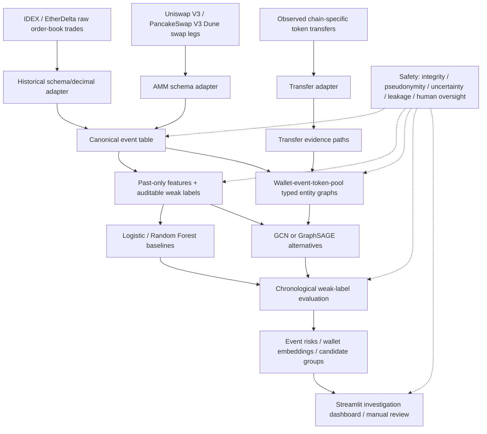

# ASTRAQUANT X 2026 / PS18 — Implemented research prototype

**Graph-based detection of coordinated wash-trading *candidates* in decentralized exchanges.**

> **DATA HONESTY FIRST:** Your attached `ASTRAQUANT_PS18_Dataset_Download_Kit.zip` contained **no actual raw trade records**. It contained the historical downloader, Dune export scripts and SQL query templates. Therefore this code bundle ships **explicitly synthetic smoke-test fixtures only**; it does not ship genuine IDEX/EtherDelta/Uniswap/PancakeSwap 2026 CSVs, verified fraud labels, or real-data model weights. You can plug in the real CSVs using the commands below. Synthetic results are *never* evidence of real fraud detection performance.

## What is implemented

- **Exchange-aware ETL:** IDEX/EtherDelta *order-book* maker/taker records vs Uniswap/PancakeSwap V3 *AMM* wallet-swap-pool-token records. No invented AMM wallet counterparty.
- **Token quantities:** historical raw IDEX/EtherDelta token amounts require `token_decimals.json`. If omitted, the importer leaves normalized amounts missing rather than pretending raw integers are tradable units. `EtherDollarPrice.csv` is retained in the acquisition kit, but this MVP does **not** fabricate historical USD prices or join them automatically.
- **Wallet evidence:** chain-scoped identifiers and observed token-transfer path searching (2–4 hops), never common-owner attribution.
- **Time-aware features + auditable weak labels:** *suspicious candidate (1), organic candidate (0), ambiguous (-1)*; all derived from event and earlier observations, not future events. This is agreement with a heuristic rule, not validated fraudulent intent. `label_reason_codes` and transfer IDs are saved.
- **GNNs:** real pure-PyTorch 2-layer **GCN** and **GraphSAGE** message passing on event-centered typed-node graphs. They are separate alternatives. The full temporal relational heterogeneous GNN from the design PDF remains **future work**, not implemented.
- **Baselines:** Logistic Regression and Random Forest, plus saved models, candidate classifications and model/label comparison plots.
- **Graph embeddings:** actual event-node and wallet-node message passing embeddings (`models/<source>/{gcn,sage}/*embeddings.csv`).
- **Coordinated groups:** observed trade/transfer connected components, plus separately marked AMM pool-time correlations; no fictitious transfer edges.
- **Dashboard + safety:** Streamlit offline visualization, evidence, uncertainty/manual review queue, leakage checks, audit report and CSV export.

## System requirements

Python 3.11+; recommended >=8 GB RAM for development. Windows PowerShell, Mac or Linux. Most code uses Pandas, scikit-learn, NetworkX, NumPy, PyTorch. `streamlit` + `plotly` for the dashboard. **PyTorch Geometric is not required.** Model training on the included small synthetic fixture runs on CPU. On real data, restrict `--max-events` and `--limit-per-source` until memory profiling is complete.

```bash
python -m venv .venv
# macOS/Linux: source .venv/bin/activate
# Windows PowerShell: .venv\Scripts\Activate.ps1
pip install -r requirements.txt
```

## 1. Run a complete OFFLINE SYNTHETIC SMOKE DEMO

```bash
# macOS/Linux
bash run_demo.sh
# Windows: run_demo_windows.bat

# Alternative manual:
python scripts_generate_demo.py
python -m src.data --idex data/synthetic/idex.csv --etherdelta data/synthetic/etherdelta.csv --uniswap data/synthetic/uniswap.csv --pancakeswap data/synthetic/pancakeswap.csv --decimals data/synthetic/token_decimals.json --ethereum-transfers data/synthetic/ethereum_transfers.csv --bnb-transfers data/synthetic/bnb_transfers.csv
python -m src.train --source uniswap --epochs 12 --max-events 640
python -m src.infer --source uniswap --arch sage --max-events 640
python -m src.safety --source uniswap
streamlit run app/main.py
```

`data/synthetic/` files are programmatically **fabricated fixtures** with several repeated/circular-looking patterns. The synthetic wallet addresses, token addresses and transaction hashes are not chain evidence. The classifier is trained on weak candidate labels **generated from these fabricated patterns**, so its resulting figures cannot be claimed as real-world measured accuracy.

## 2. Use real attached-source DATASETS (download/export required)

Retrieve the original raw CSVs using the scripts in `third_party/dataset_download_kit/`, or from these official/public sources:

- Zenodo historical: https://zenodo.org/records/4540223 (`IDEXTrades.csv`, `EtherDeltaTrades.csv`, `token_decimals.json`)
- Reproduction code and exact historical columns: https://github.com/friedhelmvictor/lob-dex-wash-trading-paper
- Dune historical/recent DEX trades: https://dune.com/data/dex-trading (query and export the appropriate `dex.trades` rows)
- Dune token transfers: https://dune.com/data/transfers (export the corresponding chain/time window)

For example, after saving your **actual** raw input files:

```bash
python -m src.data \
 --idex data/raw/IDEXTrades.csv \
 --etherdelta data/raw/EtherDeltaTrades.csv \
 --uniswap data/raw/uniswap_v3_ethereum_2026.csv \
 --pancakeswap data/raw/pancakeswap_v3_bnb_2026.csv \
 --ethereum-transfers data/raw/ethereum_wallet_transfers_2026.csv \
 --bnb-transfers data/raw/bnb_wallet_transfers_2026.csv \
 --decimals data/raw/token_decimals.json \
 --limit-per-source 50000
```

**Start smaller** than 50,000 trades/source for GNN training: `--max-events 500` or `1000`. The importer reads only the first N records and writes `data/processed/trades.csv`, `transfers.csv`, `data_audit.json`. Change `--limit-per-source` to 0 for full files only if you have enough memory. **The history limit is a deterministic first-N pilot, not a random or representative sample.**

For *recent-only* datasets (with no historical downloads) omit historical CLI arguments. To train separately by exchange (recommended, avoids mixing old order-books with recent AMMs):

```bash
python -m src.train --source idex --max-events 1000
python -m src.train --source etherdelta --max-events 1000
python -m src.train --source uniswap --max-events 1000
python -m src.train --source pancakeswap --max-events 1000
python -m src.infer --source uniswap --arch sage --max-events 1000
python -m src.safety --source uniswap
streamlit run app/main.py
```

**Important:** For a given source, if your small pilot does not contain both weak candidate classes after chronological splitting, the trainer **stops** rather than fabricating metrics. Increase the span or audit/change your label policy explicitly.

## Actual dataset column mapping

| Source | Adapter | Event actor | Counterparty / pool | Token amount normalization |
|---|---|---|---|---|
| IDEX raw | `--idex` | `taker` | observed `maker` | raw `amount`, `amountBuy` and `amountSell` + decimals; direction from maker order |
| EtherDelta raw | `--etherdelta` | `give` | observed `get` | raw `amountGive`, `amountGet` + decimals; direction from maker order |
| Historical preprocessed | same flags | `taker` | `maker` | `amountBoughtReal`, `amountSoldReal` |
| Uniswap V3 | `--uniswap` | `tx_from` (transaction origin) | `project_contract_address` = emitted contract/pool | `token_sold_amount`, `token_bought_amount`, `amount_usd` |
| PancakeSwap V3 | `--pancakeswap` | `tx_from` (transaction origin) | `project_contract_address` | same normalized Dune columns |
| Dune token transfers | `--ethereum-transfers`, `--bnb-transfers` | `from_address` | `to_address` | `amount` and relevant token contract; *not a swap* |

AMM `tx_from` may be a relayer, keeper or router. You cannot conclude it is an end-user. A Dune `dex.trades` row is often a *swap leg*, not necessarily one independent end-user economic trade. Multi-hop routes may have multiple legs; don't sum them blindly. The MVP scores legs/events and doesn't calculate total genuine transaction volume.

**Known coverage gaps:** The pack implements source-specific normalization for the documented paper CSV schemas and the SQL starter exports. It hasn't been validated against an actual downloaded 3.2 GB Zenodo CSV or a live 2026 Dune export. Vendor schema and address-role changes require an audit. The imported token-transfer query can be limited to a wallet sample and should not be interpreted as a complete chain funding graph.

## 3. Architecture changed for the data



**Current GNN architecture**: event-centered ego graphs consisting of one target event, its observed actor, relevant maker (order-book) **or** pool (AMM), tokens, and recent prior events and observed transfer paths. Two message passing layers yield event risk and wallet embeddings. Graphs contain no future events relative to a target event. This is a practical typed-node graph with ordinary GCN/SAGE projection, not an already implemented relation-specific or continuously updated temporal heterogeneous GNN. This makes the project data-compatible now.

## 4. Safety / responsible AI

1. Candidate labels only: `1` suspicious, `0` organic-candidate, `-1` ambiguous. Never say confirmed fraudulent/organic. Label confidence remains unverified without external adjudication.
2. Retrospective event-level scoring: the event is scored using its own fields and all earlier events in the selected source/time window. Later events are excluded from its graph; **the system does not predict future trades**.
3. Single weak rule only = ambiguous; no early full observation window = ambiguous. No validated malicious/benign labels are provided by the input sources.
4. Strict evaluation uses only a narrow, low-leakage tabular baseline feature set. However graphs still describe the behaviour used by the weak-label rules; high F1/PR-AUC measures **rule agreement** and cannot independently prove wash-trading detection ability.
5. Contract/pool/actor fields are not ordinary wallet ownership links. Shared pool or similar timing does not imply the same owner. No automatic account blocking.
6. Inference abstains near its validation threshold and on ambiguous evidence. A CSV review queue is produced for a human reviewer.
7. Separate model training by source. Do not report Dune scores as true fraud accuracy without independently validated labels, and don't compare DEX models on noncomparable targets.

## 5. Actual artifact map

| Path | Contents |
|---|---|
| `src/data.py` | Historical/AMM/transfer normalizers + checksums + data audit |
| `src/features.py` | Causal rolling features, transfer paths, three-tier weak labels |
| `src/graph.py` | Typed-node ego-graphs; observed-only edges; graph batches |
| `src/model.py` | True 2-layer GCN and GraphSAGE in PyTorch |
| `src/train.py` | Chronological splits, baseline training, GNN checkpoints, charts and embeddings |
| `src/coordination.py` | Observed wallet groups + distinct AMM co-activity candidate groups |
| `src/infer.py` | Load trained checkpoints, score DEX transactions, abstain when uncertain |
| `src/safety.py` | Evidence-aware human review queue + safety report |
| `app/main.py` | Offline Streamlit detection prototype; graph evidence and CSV exports |
| `tests/test_pipeline.py` | Schema, transfer paths, no future leakage, GNN forward tests |
| `data/synthetic/` | Fabricated schema-compatible fixtures (NOT real DEX data) |
| `third_party/dataset_download_kit/` | Original attached download scripts and SQL queries |

## 6. Review-stage map and known limitations

- **Review 1**: dataset schema/limitations, source-aware architecture, safety layer, mathematical graph definition, weak label policy.
- **Review 2**: run imported data, train GCN/GraphSAGE, export event & wallet embeddings, evaluate against weak labels on chronological splits.
- **Review 3**: live app and real-data audit, validate independent labels if possible, sensitivity comparisons, false positives and external wallet evidence. Synthetic runs are merely test coverage.

**Not implemented yet**: verified fraud ground-truth creation, production stream ingestion, full time-aware relational GNN, exchange-independent calibrated fraud probabilities, production-scale graph sampling, production security/audit pipeline, price joins/backtesting to demonstrate trading profit. The project's official risk-output objective is a monitoring task, not a Buy/Sell/Hold trading bot.

## 7. Tests

```bash
python -m pytest -q
```

Review source-provenance and contract role notes in `data/processed/data_audit.json` before quoting any results. Refer to the original attachments and `third_party/dataset_download_kit/docs/` for source links and the full 16-page blueprint.
